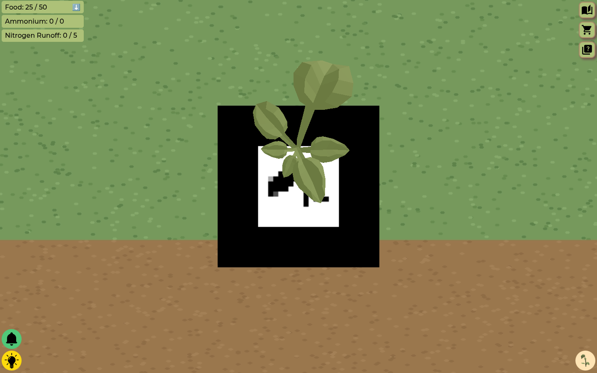
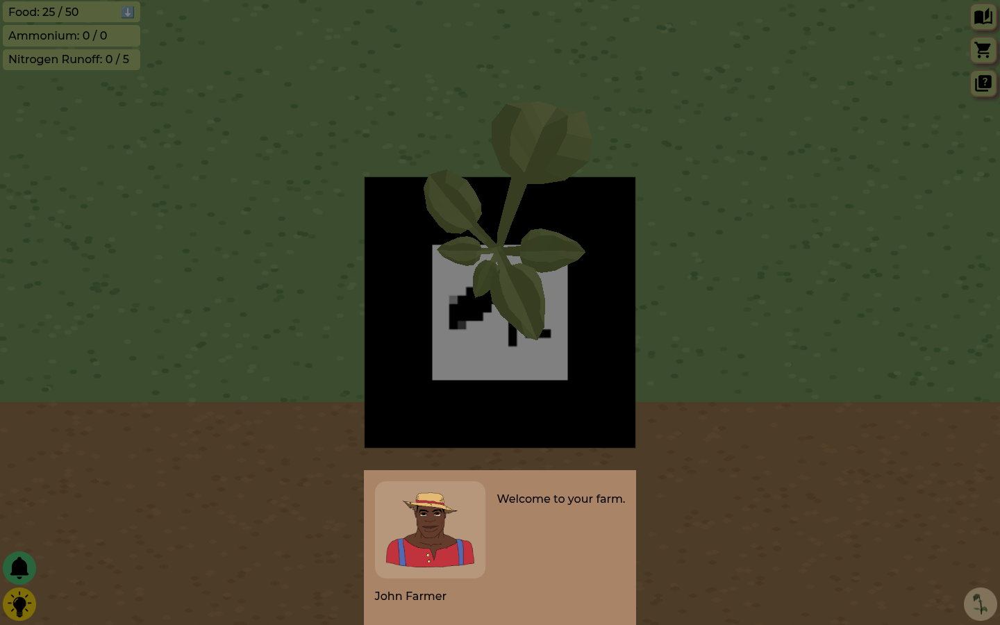
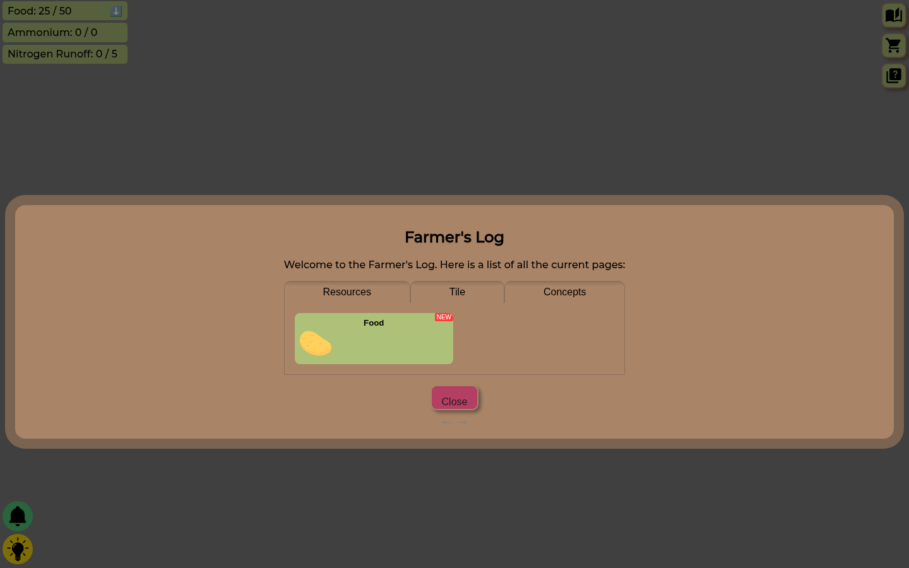

# NitroCycle

[](LICENSE)
[](https://iqp-ncpogd.github.io/nitrocycle/)
[](package.json)
[](package.json)
[](package.json)
[](https://digital.wpi.edu/concern/parent/z890rx55d/file_sets/7m01bq08w)

**An augmented-reality farming game that teaches the nitrogen cycle.** Point a phone at four printed markers and they become a plant plot, a food silo, an ammonium silo and a nitrogen fixator. Grow food, buy and fertilize plants, store ammonium, and keep nitrogen runoff below the cap. Let the runoff climb and the government shuts the farm down. Reach food security level four and the game is won.



Built in 2023 as a Worcester Polytechnic Institute Interactive Qualifying Project with the STEM Education Center of WPI for the Boys and Girls Club of Fitchburg and Leominster, so that middle-school players meet nitrogen fixation, nitrification, denitrification and runoff as choices with consequences rather than as a diagram.



## Why

The nitrogen cycle is taught as a loop of arrows, and the part that matters for food security, that fertilizer feeds crops and also runs off into water, is lost in the loop. An incremental game turns the loop into a budget. Ammonium is scarce and useful, fertilizer is a trade between a bigger harvest now and runoff later, and a neglected ammonium silo explodes. Players learn the cycle by managing it.

## How it plays

- **Four AR tiles.** Each printed pattern marker is a tile. When the camera finds a marker its menu button appears, and it hides four seconds after the marker is lost.
- **Resources.** Food and ammonium tick every second from the plants and fixators you own. Nitrogen runoff has a hard cap that rises with each food security level.
- **Plants.** A plant costs 25 food, grows from sprout to plant to wilt, and produces more at each stage until it is removed. Fertilizing a plant or a wilt with ammonium turns it into a bloom that yields 50, and adds runoff. A plot holds up to sixteen plants.
- **Silos.** Food silos raise storage through five levels. Ammonium silos store the ammonium that fixators make and need maintenance every five minutes, or they explode and dump runoff.
- **Fixators.** A nitrogen fixator makes ammonium on its own and adds a little runoff when built.
- **Levels.** Food security levels cost 100, 500, 2,000 and 10,000 food and raise the runoff cap to 10, 15, 20 and 25. Level four ends the game with confetti.
- **Tutorial, trivia and the Farmer's Log.** John Farmer walks a new player through the first plant, silo, fertilizer and fixator while Hans Ammonium tries to sell ammonium instead. A trivia question arrives every minute and pays or fines food. The Farmer's Log opens pages on the nitrogen cycle, denitrification, nitrogen fixation and each resource as they come up in play.



## How it is built

React 18 renders the whole game as DOM overlays on top of an AR canvas. `@artcom/react-three-arjs` wraps AR.js inside `@react-three/fiber`, so each marker is an `ARMarker` with a `pattern` URL under `data/patterns/` and the 3D plant, silo and fixator models under `data/models/` are glTF files loaded with three.js. The HUD, menus, tutorial, shop, trivia and Farmer's Log are plain React components, which is why the camera is only needed to reach a tile's menu. Webpack bundles `src/index.js` to `dist/`, copies `data/` and the AR.js camera calibration file beside it, and serves over HTTPS in development because `getUserMedia` needs a secure context on phones.

## Install and run

```bash
git clone https://github.com/IQP-NCPOGD/nitrocycle.git
cd nitrocycle
npm install
npm run dev        # webpack-dev-server over HTTPS on :8080, accept the self-signed certificate on the phone
npm run build      # production bundle in dist/, with /nitrocycle as the public path
npm run deploy     # publishes dist/ to the gh-pages branch
```

Print the four markers from the development documents linked below, open the site on a phone, allow the camera, and point it at a marker.

## Links

- Play: https://iqp-ncpogd.github.io/nitrocycle/
- Final report, "Turning the Nitrogen Cycle into an Augmented Reality Game" (WPI, March 2023): https://digital.wpi.edu/concern/parent/z890rx55d/file_sets/7m01bq08w
- Development documents, storyboards and marker sheets: https://tinyurl.com/wpi-iqp-nitrocycle-documents
- Marker QR codes: https://tinyurl.com/IQP-nitrocycle-QRCodes

## Credits

Charles Anderson, Philip Bui, Hasan Gandor, Tri Vien Le and Ethan Pollack, advised by Professor Andrew Teixeira, with Kathy Chen of the STEM Education Center of WPI and Allison Digirolamo of the Boys and Girls Club of Fitchburg and Leominster. Built on AR.js, three.js, react-three-fiber and React.

## License

MIT. See [LICENSE](LICENSE).
